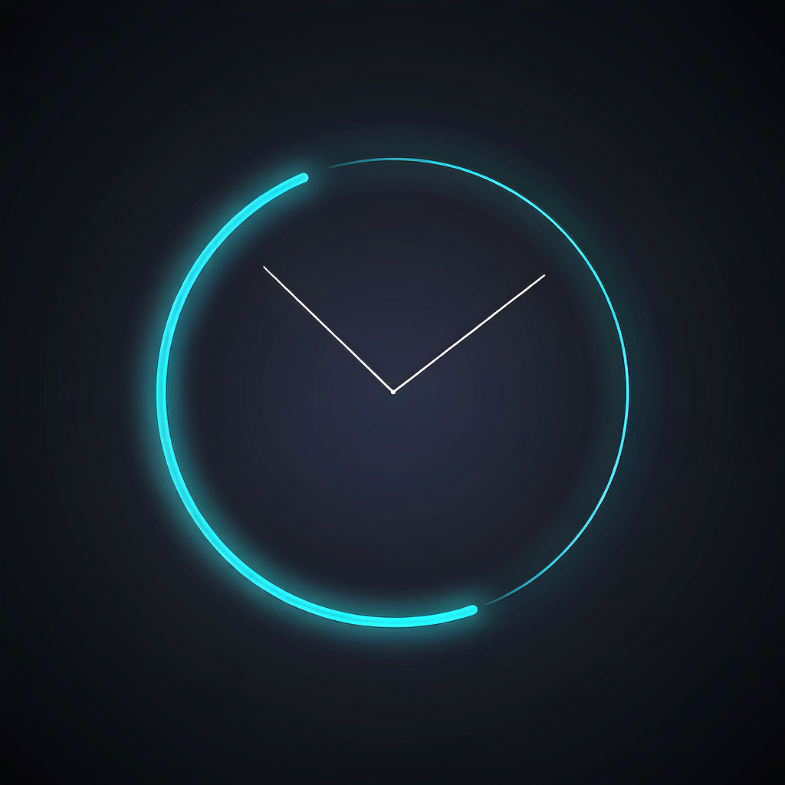

<div align="center">
  
  <h1>倒计时 · Clock App</h1>
  <p>一款用 Flutter 写的极简倒计时 + 数字时钟应用，专注于「看一眼就知道还剩多久」。</p>
</div>

<p align="center">
  
  
  
</p>

---

## 简介

**倒计时**把两件事做到了极致：一个是**番茄钟式的倒计时**，另一个是**全屏数字时钟**。没有账号、没有云同步、没有多余设置，打开即用。

它最初是为 macOS 菜单栏场景写的——把剩余时间实时顶到菜单栏上，最后 60 秒开始闪烁提醒，不用切回窗口就知道还剩多久；同时也完整支持 Android，数字时钟页在手机上会常亮显示并附带电量指示。

## 功能特性

### 倒计时（首页）

- **三个预设**：番茄时钟 25 分钟、短休息 5 分钟、长休息 15 分钟，一键切换，各自带独立配色。
- **两种自定义方式**：
  - 滑块：1 ~ 120 分钟任意时长；
  - 时间选择器：直接指定目标时刻（当前时间之后 120 分钟内），适合「我要在 15:30 提醒我」这类场景。
- **环形进度 + 剩余时间**大字展示，运行时同步显示目标时刻。
- **开始 / 暂停 / 重置 / 清空**四态控制，暂停后继续不会丢失进度。
- **结束时提醒**：系统通知 + 应用内弹窗。
- **不会漂移**：计时基于「目标时间戳」而非逐秒累加，即使应用被切到后台，回到前台时会自动重新校准剩余时间。
- **整秒对齐**：时钟与倒计时按整秒边界刷新，长跑也不会累积误差。
- **小屏适配**：屏幕高度小于 600dp 时自动切换紧凑布局（缩小圆环与按钮间距），兼容 iPhone SE 等小屏设备。

### 数字时钟页

从首页点击顶部的当前时间即可进入，全屏沉浸式显示。

- **5 套主题**，一键切换并自动记忆：

  | 主题 | 背景 | 数字 | 风格 |
  |---|---|---|---|
  | 深海（默认） | 深蓝渐变 | 白色 / 浅蓝秒数 | 沉静、低干扰 |
  | 极简黑 | 纯黑 | 纯白 | OLED 友好 |
  | 极光 | 紫绿渐变 | 浅绿 / 青色秒数 | 灵动 |
  | 霓虹城市 | 深紫 | 白色 / 粉青霓虹 | 高对比 |
  | 水墨 | 米黄纸 | 墨黑 | 唯一浅色主题 |

- **10 种滴嗒音效**：机械挂钟（默认）、石英钟、秒表 ×2、机械闹钟 ×5、计时器。默认静音，开启后整段循环播放，切换音效立即生效。
- **屏幕常亮**：进入页面自动开启，离开时自动关闭。
- **横竖屏强制切换**：不依赖系统自动旋转开关。
- **日期与星期**实时显示。
- **电量指示**（Android）：沉浸式下系统状态栏被隐藏，用右下角小胶囊显示当前电量与充电状态。
- **点击空白处**可让顶栏按钮整体淡出 / 淡入，方便纯粹看时间。

### macOS 菜单栏

- 菜单栏实时显示倒计时剩余时间（含标签，如 `番茄时钟 24:31`）。
- **剩余不足 60 秒时开始闪烁**并加 `⚠️` 前缀，提醒更醒目。
- 左键点击菜单栏图标激活主窗口，右键弹出菜单（显示主窗口 / 退出）。

## 平台支持

| 平台 | 倒计时 | 数字时钟 | 菜单栏 | 电量显示 | 说明 |
|---|:---:|:---:|:---:|:---:|---|
| **macOS** | ✅ | ✅ | ✅ | — | 主要目标平台，功能最完整 |
| **Android** | ✅ | ✅ | — | ✅ | 正式支持，含原生电量通道 |
| **iOS** | ✅ | ✅ | — | — | 可用，无菜单栏与电量显示 |
| Windows / Linux / Web | ✅ | ✅ | — | — | 脚手架完整、可编译，但未做实机验证与专项适配 |

## 技术栈

- **框架**：Flutter 3.44.1（stable）/ Dart SDK `^3.12.1`，Material 3 深色主题。
- **依赖**：

  | 包 | 用途 |
  |---|---|
  | `flutter_local_notifications` | 倒计时结束的系统通知 |
  | `audioplayers` | 滴嗒音效循环播放 |
  | `shared_preferences` | 持久化主题与音效选择 |
  | `system_tray` | macOS 菜单栏图标 |
  | `wakelock_plus` | 屏幕常亮 |
  | `cupertino_icons` | iOS 风格图标 |
  | `flutter_launcher_icons`（dev） | 一键生成全平台应用图标 |

- **零第三方依赖的两处原生实现**（刻意为之，见「设计说明」）：
  - Android `MainActivity.kt`：注册 `countdown/battery` 通道，用系统 `BatteryManager` 读取电量与充电状态；
  - macOS `AppDelegate.swift`：注册 `countdown/status_bar` 通道（激活窗口）+ 通知中心前台横幅。

## 快速开始

### 环境要求

- Flutter 3.44.1 或更高（stable 通道）
- Dart SDK `^3.12.1`
- 对应平台的构建工具链（macOS 需 Xcode，Android 需 Android SDK）

### 运行

```bash
git clone <your-repo-url>
cd clock_app

flutter pub get

# 按平台选择
flutter run -d macos
flutter run -d android
flutter run -d ios
```

> macOS 首次运行会在系统设置中弹出**通知权限**申请，允许后才能收到倒计时结束提醒。

### 构建

```bash
flutter build macos      # macOS
flutter build apk        # Android
flutter build ios        # iOS（需配置签名）
```

### 重新生成应用图标

图标源文件为 `assets/clock_app_icon.png`（1024 × 1024）。如需更换图标，替换该文件后执行：

```bash
dart run flutter_launcher_icons
```

配置位于 `pubspec.yaml` 的 `flutter_launcher_icons` 段，会同时为 Android、iOS、macOS 生成各分辨率图标。

## 项目结构

```
clock_app/
├─ lib/
│  ├─ main.dart                     应用入口（MaterialApp，深色主题，首页为倒计时）
│  ├─ models/
│  │  ├─ clock_theme.dart           5 套时钟主题的数据定义
│  │  └─ tick_sound.dart            10 种滴嗒音效的数据定义
│  ├─ pages/
│  │  ├─ countdown_page.dart        首页：倒计时（预设 / 自定义 / 通知 / 状态栏）
│  │  ├─ clock_page.dart            数字时钟页（主题、音效、横屏、电量）
│  │  └─ settings_page.dart         自定义时长设置（滑块 Tab + 时间选择 Tab）
│  ├─ services/
│  │  └─ tick_sound_service.dart    滴嗒声播放服务（单例，循环长音频）
│  └─ status_bar_manager.dart       macOS 菜单栏管理（含倒计时闪烁提醒）
├─ assets/
│  ├─ clock_app_icon.png            应用图标源文件（1024×1024）
│  └─ sounds/                       10 个 mp3 滴嗒音效
├─ android/  ios/  macos/  linux/  windows/  web/    各平台工程
└─ test/                            测试目录
```
